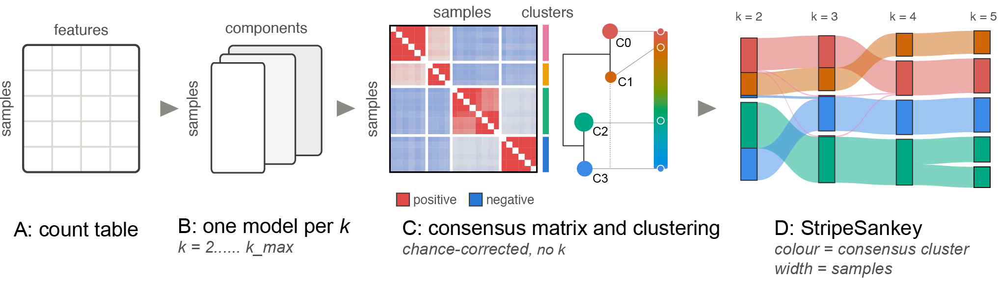
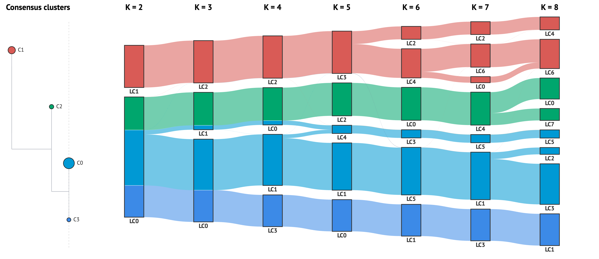
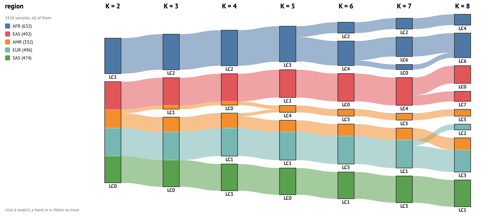
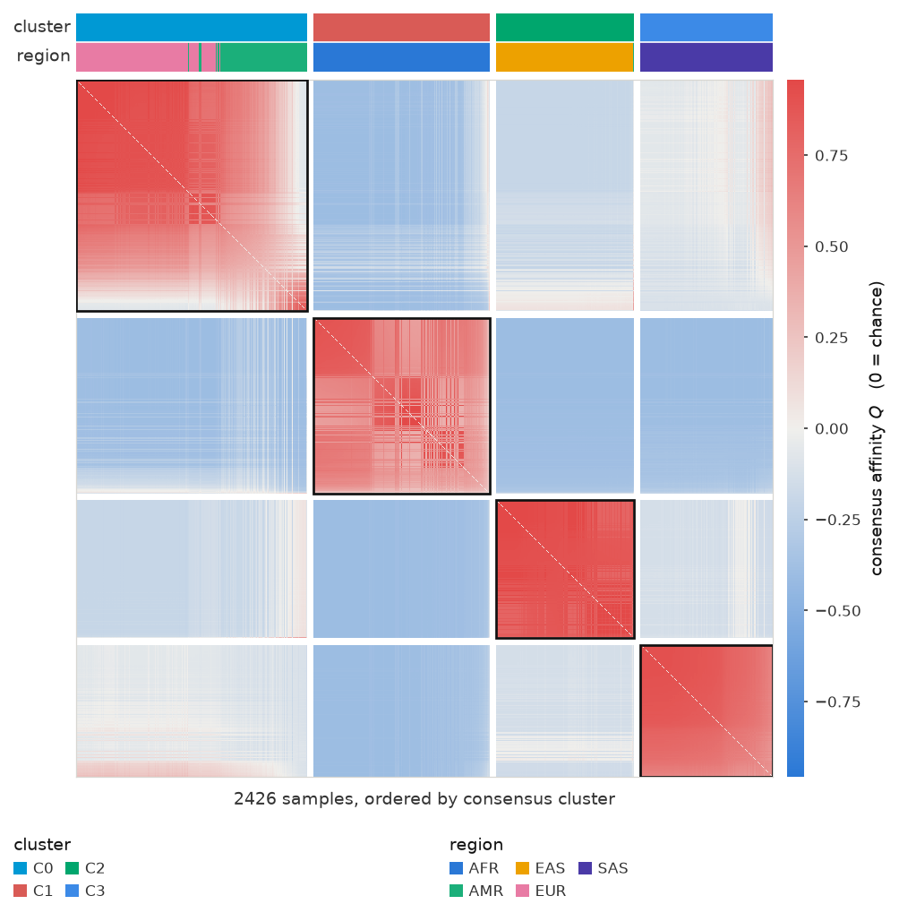

<p align="center">
  
</p>


---

StripeSankey fits a mixed membership model at several `k` (a *sweep*) and draws all of it as one figure. Every ribbon entering or leaving a node sums to exactly that node, and a ribbon's thickness is a number of samples you can read off.

The pipeline supports LDA and NMF, and takes three tables: a **count matrix**, a **per-feature annotation** (like taxa in microbiome) and **per-sample metadata**.

| table | index | columns |
|---|---|---|
| `counts` | sample id | feature id |
| `feature_annotation` | feature id | annotation levels |
| `metadata` | sample id | sample variables |

The pipeline also lets users bring their own sweep, computed elsewhere (see *Fit your customized models*).



```bash
pip install stripesankey
```

## Fit models with StripeSankey

### 1 — `prepare`
`prepare` checks that the three tables line up (matching sample and feature ids, usable counts), collapses the counts to one annotation `level` if you give one, and writes the result to `base/intermediate/` for `sweep` to read.

```python
import stripesankey as ss
base = 'LOCAL FOLDER PATH TO SAVE CACHE'
# fit LDA/NMF models via StripeSankey, example of microbiome count table
ss.prepare(base, counts, feature_annotation, metadata, level="genus")
```
`level` is any column of `feature_annotation`. For instance, in microbiome or ecology, you may want to group your count table at genus level.


### 2 — `sweep`

One fit per k, each saved to disk as it finishes.

```python
ss.sweep(base, k_range=range(2, 11), implementation="nmf", random_state=42)
```

Implementations include:

| Algorithm | implementation | source lib | API |
|---|---|---|---|
| `LDA` | Variational Bayes | [*gensim*](https://radimrehurek.com/gensim/auto_examples/tutorials/run_lda.html#sphx-glr-auto-examples-tutorials-run-lda-py) | lda_gensim |
| `LDA` | Markov Chain Monte Carlo | [*MALLET*](https://mimno.github.io/Mallet/) | lda_mallet |
| `NMF` | generalized KL loss, initialised with *nndsvdar* | [*scikit-learn*](https://scikit-learn.org/stable/modules/generated/sklearn.decomposition.NMF.html) | nmf |

After fitting, results are saved in the *base* folder with the structure below:

```
base/
├── intermediate/                       # written by prepare
│   ├── features.csv                    
│   ├── feature_annotation.csv
│   └── manifest.json
└── results/                            # written by sweep
    ├── W/W_{k}.csv                     # one file per k
    ├── H/H_{k}.csv                     # one file per k
    ├── diagnostics/topic_diff_{k}.csv  # LDA (gensim) only
    ├── consensus.json                  # consensus cluster of each sample
    ├── run_info.json                   # k list, implementation, convergence per k
    └── metrics.csv
```

| | shape | on disk |
|---|---|---|
| `W` | sample × LC | `results/W/W_{k}.csv` |
| `H` | LC × feature | `results/H/H_{k}.csv` |

## Fit your customized models

### Bring your own model via python

Define a function that takes `k` and a seed and returns an unfitted model, then pass it as `implementation`. `sweep` fits it at every `k` and saves `W`, `H` and the consensus, as it does for the built-in implementations:

```python
from sklearn.decomposition import NMF

def my_nmf(k, seed):
    return NMF(n_components=k, beta_loss="kullback-leibler", solver="mu",
               init="nndsvdar", max_iter=3000, random_state=seed)

ss.sweep(base, k_range=range(2, 11), implementation=my_nmf, random_state=42)
```

The model needs scikit-learn's interface: `fit_transform(X)` returns `W` (sample × LC) and `components_` holds `H` (LC × feature).

### Bring your own sweep via other programming languages

If your model runs in another language, such as R, or in a well-established tool like *ADMIXTURE*, run the sweep there and save each `W` as `base/results/W/W_{k}.csv`: the sample id in the first column, then one column per LC, rows summing to 1, and the same samples in the same order at every `k`. Then run `sweep` without `k_range`:

```python
ss.sweep(base)
```
[`example/population`](example/population) does this with [pong](https://github.com/ramachandran-lab/pong)'s precomputed ADMIXTURE results for the 1000 Genomes (K = 2…8).

## Plotting

Both figures read the sweep from `base`, wherever it was fitted.

### stripesankey — coloured by consensus cluster

```python
fig = ss.stripesankey(base, metadata_df=metadata, hover_field=["group"])
```



*An interactive version is available in [`example/population/viz/stripesankey_K2-8.html`](example/population/viz/stripesankey_K2-8.html).*

Click a band, a ribbon or a cluster chip to trace those samples across every
`k`. Click a `K =` label to focus that column — it restacks by the first
`hover_field`. Read the selection back from `fig.selected_samples`.

### metasankey — the same figure, cut by metadata

```python
fig = ss.metasankey(base, metadata_df=metadata, hover_field=["group"])
```



*An interactive version is available in [`example/population/viz/metasankey_K2-8.html`](example/population/viz/metasankey_K2-8.html).*

Identical layout, one thing changed: a node is sliced into a metadata field's
categories instead of into clusters.

### affinity heatmap — the matrix the clusters came from

```python
Q = ss.consensus_affinity(ss.load_W(base))                                         # the affinity matrix
fig, order, labels = ss.affinity_heatmap(Q, above=metadata, annotations=["group"])  # the plot
```

<p align="center">
  
</p>

`Q` is the signed, chance-corrected co-membership: positive means two samples
share components *more* than chance, negative *less*. Samples are ordered by
consensus cluster by default.


## Hard labels

For an ensemble of **hard** labels instead of soft assignments — k-means at
several `k`, or different algorithms at one `k`:

```python
fig = ss.hardstripe(labels_df, colorby="consensus", metadata_df=metadata)
```

## Citation


## License

MIT
